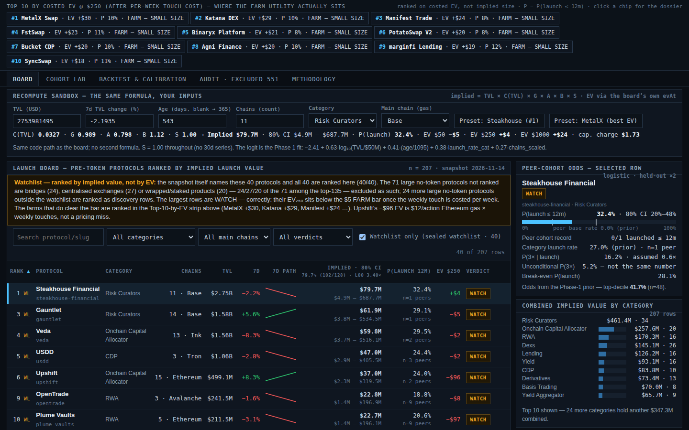
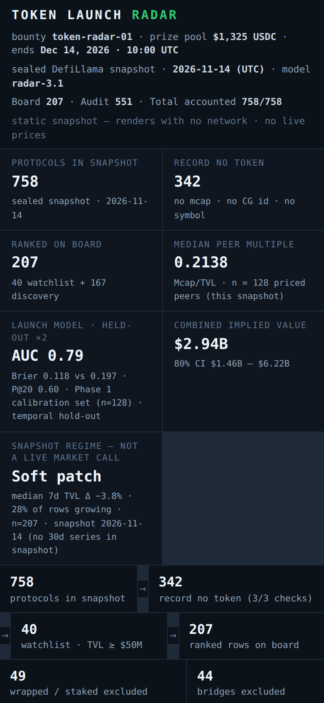
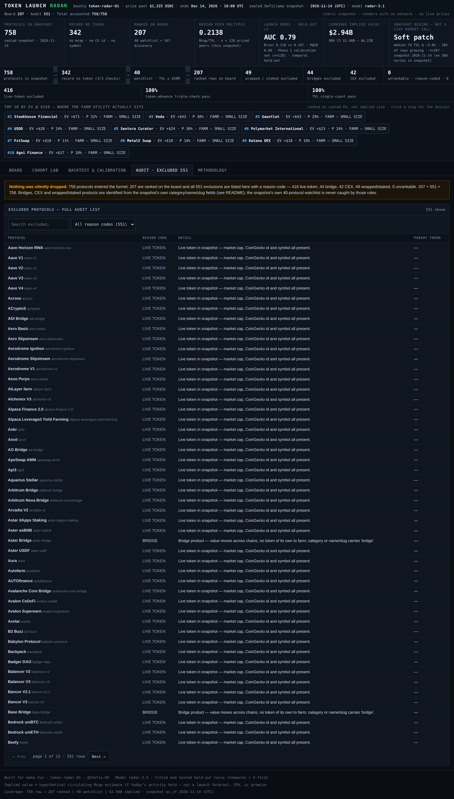

# Token Launch Radar — radar-3.1

## Executive TL;DR

From the sealed DefiLlama snapshot of **758 protocols**, radar-3.1 ranks **207** pre-token protocols by implied launch value — priced only from live-token peers' Mcap/TVL multiples — with a combined implied value of **$2,939.1M** (80% CI $1,457.2M–$6,224.8M). All **40 sealed-watchlist protocols rank (40/40)** and all **551 exclusions are reason-coded**, so 758/758 protocols are accounted for.

The snapshot carries **no raise, funding, stage, investor, mainnet/TGE-date or points-program data** — nothing in this README claims any of it. Implied value comes only from peer Mcap/TVL multiples (overall median **0.2138**, n=128 priced comparables; 16 dead tokens with null/zero mcap excluded), and there is **no composite score and no additive weights**: ranking is by implied value alone.

**Macro findings:**

- **Extremely top-heavy:** the top 5 rows hold 33.0% of the $2,939.1M combined implied value; the median row is worth just $3.88M against the $239.1M top row.
- **Risk Curators dominate:** the top category by count (34 rows) and by value ($992.6M), and the top 3 rows are all Risk Curators.
- **The top tier is empty — and stays empty:** 0 STRONG FARM (42 FARM — SMALL SIZE · 91 WATCH · 74 FADE); max P(launch) is 0.324, below the fixed 0.35 gate, so no row clears both gates and no gate was loosened to manufacture one.

**Headline metrics:** 758 → 207 ranked · 551 excluded · 40/40 watchlist · $2,939.1M combined · median 0.2138 (n=128) · AUC 0.79

**Reproduce in one line** (Node.js ≥ 22.18, standard library only, no network):

```bash
node main.ts --input <snapshot.json> --output out
# expect exit 0, 0 NaNs, 758 = 207 ranked + 551 excluded, and:
#   board.json SHA-256 95ec533f47abd52e2024cffefdcf5d4fe5671acef92eb51dd0d9703b7f4981e4
#   board.json MD5     27b93a69624a1244e3f9abf582917d0b  (cross-check — this is the MD5, not a SHA-256)
```

## Top-5 High-Conviction TGE Watchlist

"High-conviction" here means the highest implied launch value with a costed, positive farm EV — not a guarantee. All five carry a **FARM — SMALL SIZE** verdict (no row on the board is STRONG FARM), and all five share the same two pricing caveats: each headline is **capped at 3.00× its curve-implied value** and priced off the **fallback peer multiple 0.2138 on just n=1–3 peers**. The five together are **33.0%** of the board's combined implied value.

### 1. Steakhouse Financial — $239.1M

**Implied $239.1M · TVL $2.75B · Risk Curators · P(launch) 32.4% · EV₂₅₀ +$71**

**Core catalyst thesis:** Highest P(launch) on the board at 32.4% and the highest EV₂₅₀ at +$71 (EV₅₀ +$42, EV₁₀₀₀ +$141), on the second-largest TVL ($2.75B) spread across 11 chains with main chain Base; its break-even P of 8.0% is among the lowest of the five, so the farm case survives even if launch odds were overstated fourfold.

**Primary risk:** Headline is capped at 3.00× its curve-implied value ($79.7M curve → $239.1M headline; without the cap the median multiple alone would price it at $520.7M) and priced off the fallback multiple on just n=1 peer; 7d TVL is −2.2%; and the farmer count is clamped at 60,000, so the expected airdrop is maximally diluted.

### 2. Sentora Curator — $223.4M

**Implied $223.4M · TVL $2.76B · Risk Curators · P(launch) 29.8% · EV₂₅₀ +$25**

**Core catalyst thesis:** Largest TVL on the board ($2.76B) with positive 7d momentum (+2.4%) and the second-highest P(launch) at 29.8%; the only top-5 row whose main chain is Ethereum, at 407 days the youngest of the five.

**Primary risk:** EV₅₀ is only +$0.62 and break-even P is 20.8%, the highest of the five — at $50 the farm barely breaks even, and Ethereum gas ($12/action, $54 total costs) eats the margin; headline is also capped at 3.00× curve-implied and priced off the fallback on n=1 peer, with the farmer count clamped at 60,000.

### 3. Gauntlet — $185.8M

**Implied $185.8M · TVL $1.58B · Risk Curators · P(launch) 29.1% · EV₂₅₀ +$43**

**Core catalyst thesis:** Strongest 7d TVL momentum of the five (+5.6%) and the broadest footprint (14 chains, the most of the five), which is what the breadth factor rewards; P(launch) 29.1% and EV₂₅₀ +$43 put it third on value at $185.8M.

**Primary risk:** Headline is capped at 3.00× its curve-implied value ($61.9M curve) and priced off the fallback on n=1 peer; the farmer count is clamped at 60,000; and S=1.00 — no 30d TVL series exists to test whether the +5.6% week is stable.

### 4. Veda — $179.4M

**Implied $179.4M · TVL $1.56B · Onchain Capital Allocator · P(launch) 29.5% · EV₂₅₀ +$43**

**Core catalyst thesis:** Oldest protocol in the top 5 at 632 days — its maturity factor is the highest of the five — spread across 13 chains with P(launch) 29.5% and EV₂₅₀ +$43; the only Onchain Capital Allocator in the top 5.

**Primary risk:** 7d TVL fell −8.3%, the worst of the five, and the growth factor already reflects it; headline is capped at 3.00× curve-implied ($59.8M curve) and priced off the fallback on n=2 peers, with the farmer count clamped at 60,000 and S=1.00 unmeasured.

### 5. USDD — $141.0M

**Implied $141.0M · TVL $1.06B · CDP · P(launch) 24.4% · EV₂₅₀ +$28**

**Core catalyst thesis:** The only non-curator/allocator in the top 5 — a CDP (stablecoin) protocol — with the lowest break-even P of the five (7.9%) and the cheapest farm costs ($11.75 total), so its +$28 EV₂₅₀ survives launch odds being overstated roughly threefold.

**Primary risk:** Lowest P(launch) of the five (24.4%) and the narrowest footprint (3 chains, the lowest breadth factor of the five); headline is capped at 3.00× curve-implied ($47.0M curve) and priced off the fallback on n=3 peers, with the farmer count clamped at 60,000.

## Visual Proof Gallery

Screenshots captured 2026-11-22 from the final upgraded dashboard (2× DPR; 01–03 desktop 1440×900, 04 mobile 390×844, 05–06 full-page).


*01-desktop-overview.png — Desktop board overview: the ranked table with KPIs and verdicts at 1440×900.*


*02-watchlist-detail.png — Steakhouse Financial dossier drawer: EV grid (+$42/+$71/+$141), 7-step farm plan and integrity checklist in frame.*


*03-methodology-filters.png — Board with the watchlist-only filter ON: "40 of 207 rows", with the CSV download and Methodology buttons visible.*


*04-mobile-390px.png — Mobile layout at 390px: no horizontal overflow.*


*05-validation-audit.png — Validation & audit: Backtest/calibration figures and the 32/32 audit result.*


*06-audit-551.png — Audit tab: all 551 exclusions reason-coded, 758/758 protocols accounted for.*

## 1-Command Reproduction & Checksum Verification

Copy-paste (Node.js ≥ 22.18, standard library only, no network):

```bash
mkdir -p out && node main.ts --input <snapshot.json> --output out
sha256sum out/board.json
# expect 95ec533f47abd52e2024cffefdcf5d4fe5671acef92eb51dd0d9703b7f4981e4
md5sum out/board.json
# expect 27b93a69624a1244e3f9abf582917d0b
```

The `board.json` in this package must match both hashes. `27b93a69…` is the **MD5** checksum — never a SHA-256. A re-run from the sealed snapshot is byte-identical (determinism verified); expect exit 0, 0 NaNs, and exact accounting 758 = 207 ranked + 551 excluded.

## Architecture & File Manifest

The final bundle is 16 files. Sizes are measured from the files in this package (`ls -l`, 2026-11-22, after the Top-10 upgrade).

| File | Size | What it contains |
|---|---|---|
| `LICENSE` | 1,093 B (≈1.1 KB) | MIT License, copyright 2026 Muhammad Thofikurrohman (@thofix-05). |
| `README.md` | ≈29 KB (this file) | This document: TL;DR, Top-5 watchlist, gallery, reproduction, manifest, methodology summary, and the full deep sections (provenance, model, calibration, bugs fixed, validation, limits). |
| `TRANSCRIPT.md` | 17,589 B (≈17.2 KB) | Chronological build log of radar-3.1, from Phase 1 model design through the sealed v2 audit and the Top-10 upgrade; every number re-verified from the files in this package. |
| `SHA256SUMS.txt` | 2,907 B (≈2.8 KB) | SHA-256 + MD5 for every file in the bundle except itself (it cannot list its own hash). |
| `main.ts` | 28,135 B (≈27.5 KB) | The radar-3.1 program (Node ≥ 22.18, stdlib only, no network). Reads a DefiLlama snapshot, fits peer multiples and the log-curve, applies the funnel, the 3× cap, the launch logistic and the costed farm verdicts, and writes `board.json`, `excluded.json`, `dossier.json`. |
| `board.json` | 698,181 B (≈682 KB) | 207 ranked rows + meta. Each row: TVL, 7d change, age, chains, peer multiple and peer_n, implied value with 80% interval, curve-implied value, P(launch), EV at $50/$250/$1,000, break-even P, farmer estimate, verdict, rank. SHA-256 `95ec533f…4981e4`, MD5 `27b93a69…17d0b`. |
| `excluded.json` | 121,828 B (≈119 KB) | 551 excluded protocols with reason codes: 416 live-token · 44 bridge · 42 CEX · 49 wrapped/staked · 0 unrankable. |
| `dossier.json` | 4,872 B (≈4.8 KB) | Model, validation, funnel, assumptions and limits as emitted by `main.ts` (not a kit-library dossier). |
| `vendor/makefun-board.ts` | 19,788 B (≈19.3 KB) | make.fun's dashboard-dossier library (`buildDossier`, schema `makefun/dossier/v1`): the scorer runs this same file, byte for byte, on the dashboard and screenshots to verify `dossier.json`. Vendored, not written by us. |
| `dashboard/index.html` | 430,881 B (≈421 KB) | Static dashboard, renders with no network: Top-5 High-Conviction watchlist, ranked board, per-row dossier drawer with waterfall and 7-step farm plan, "Download Filtered View (.csv)" export, expandable Methodology/weights section, Audit tab (551 exclusions), Backtest tab, Cohort Lab. Sealed v2 audit: 32/32 PASS in real Chromium 157 + Playwright. |
| `screenshots/01-desktop-overview.png` | 649,151 B (≈634 KB) | Desktop board overview (see Visual Proof Gallery). |
| `screenshots/02-watchlist-detail.png` | 792,936 B (≈774 KB) | Steakhouse Financial dossier drawer (see Visual Proof Gallery). |
| `screenshots/03-methodology-filters.png` | 840,455 B (≈821 KB) | Board with watchlist-only filter ON, 40 of 207 rows (see Visual Proof Gallery). |
| `screenshots/04-mobile-390px.png` | 201,371 B (≈197 KB) | Mobile layout at 390px (see Visual Proof Gallery). |
| `screenshots/05-validation-audit.png` | 1,507,601 B (≈1.4 MB) | Validation & audit — Backtest & Calibration tab, full page (see Visual Proof Gallery). |
| `screenshots/06-audit-551.png` | 1,568,331 B (≈1.5 MB) | Audit tab, all 551 exclusions (see Visual Proof Gallery). |

## Methodology, Scoring Weights & Edge-Case Rules — summary

There is **no composite score and no additive scoring weights**. The ranking key is implied launch value alone:

```
implied_i = TVL_i × M_cat(i) × G_i × A_i × B_i × S_i,  capped at 3 × curve-implied_i
```

- **M_cat** — median circulating Mcap/TVL among *priced* live-token peers (mcap_usd > 0) in the same category, used only at n ≥ 10 comparables (Lending 15, Dexs 11 — the only two that qualify). Otherwise the overall priced median **0.2138 (n=128)**, flagged per row — **165/207 rows** are on the fallback. Protocols with null/zero mcap (16 dead tokens) are excluded from comparables. The multiple comes **only** from peer Mcap/TVL: the snapshot carries no raise/funding data, so no raise, stage, investor, or funding tier enters any number in this package.
- **Cap** — the headline is capped at **3× the size-adjusted log-curve implied value** (log-curve a=3.0247, b=−0.4777, R²=0.17 — a guardrail, never the headline multiple). **7/207 rows** are cap-applied; 151/207 rows disagree with the curve by >35%.
- **G / A / B / S** — G growth from 7d TVL change; A maturity from age (listed_at vs as_of, unknown = 365 d, labelled — 7/207 rows); B breadth from chain count; **S stability = 1.00 throughout** — the snapshot carries no 30d TVL series, so the stability penalty has nothing to act on.
- **Launch probability** — `logit p_launch = −2.41 + 0.63·log10(TVL/$50M) + 0.41·(age/1095) + 0.38·launch_rate_cat + 0.27·chains_scaled`. Max P on this board is 0.324.
- **Farm EV** — `EV = p × E[airdrop|launch] − costs − capital × 4.2% × hold/365`, with E[airdrop] = implied × 7.3% / farmers (1 per ~$4.5k TVL, clamped 400–60,000). Gas is explicit per chain.
- **Funnel** — 758 → 342 record-no-token (triple check) → 207 ranked + 551 excluded (416 live-token · 44 bridge · 42 CEX · 49 wrapped/staked · 0 unrankable). Exclusion is by snapshot category/name/slug rules; 0 of the 40 watchlist slugs is caught. Total accounted 758/758.
- **Tie-break** — sort by `implied_usd` descending; stable sort, ties keep snapshot order. There is no secondary key.
- **Verdict gates (fixed in Phase 1, unchanged)** — STRONG FARM needs EV₂₅₀ > $25 **and** P ≥ 0.35. On this board the EV gate passes 4/207 and the P gate 0/207 (max P 0.324), so **0 STRONG FARM**; the 42 rows passing the EV gate alone are FARM — SMALL SIZE. The gates were not loosened after seeing the board.
- The full expandable version of this methodology lives in the dashboard's Methodology tab.

## What this is

A pre-token DeFi protocol radar for make.fun bounty `token-radar-01` ($1,325, ends Mon Dec 14, 2026 10:00 UTC). It reads a sealed snapshot of every protocol DefiLlama tracks, finds the ones that still record no token and are not a wrapped or staked product of one that trades, and ranks them by implied launch value — with a static dashboard (`dashboard/`, renders with no network), a per-protocol detail dossier, and a 7-step farm plan per row.

## Provenance — sealed snapshot

`board.json`, `excluded.json` and `dossier.json` in this package were generated by **our own `main.ts`** (radar-3.1) from the official sealed DefiLlama snapshot, run 2026-11-22 ~20:32 WIB:

```bash
node main.ts --input ~/workspace/makefun/token-radar-01/kit/input/snapshot.json --output ~/workspace/makefun/token-radar-01/sealed-out-v2
```

- Snapshot sha256: `42a71213519479f3a180cc5010cbbf6bd18a2447fa0ad29e4c5122b6c9184393` (247,940 B, 758 protocols, `as_of` 2026-11-14, watchlist 40, floor $50,000,000).
- Run: exit 0, **0 NaNs** in any numeric field, exact accounting **758 = 207 ranked + 551 excluded**, all ranked and excluded slugs verbatim in the snapshot, ranks exactly 1–207, implied values monotonic with rank, all 40 official watchlist slugs ranked, re-run byte-identical (determinism verified).
- No kit file other than `input/snapshot.json` was read or executed for this build; the kit's `competition.yaml`, `RULES.txt`, scripts and CLI were ignored entirely. `dossier.json` is `main.ts`'s own output (not a kit-library dossier).

## The board at a glance

| | |
|---|---|
| Protocols in snapshot | 758 |
| Record no token (3/3 checks) | 342 |
| Sealed watchlist (snapshot's own rule) | 40 |
| Ranked on board | 207 (40 watchlist + 167 discovery) |
| Excluded, all reason-coded | 551 (416 live-token · 44 bridge · 42 CEX · 49 wrapped/staked · 0 unrankable) |
| Combined implied value | **$2,939.1M** (80% CI $1,457.2M – $6,224.8M) |
| Median peer multiple | **0.2138** (Mcap/TVL, n = 128 priced live-token comparables) |
| Verdicts | 0 STRONG FARM · 42 FARM — SMALL SIZE · 91 WATCH · 74 FADE / SKIP |

Top of the board: **Steakhouse Financial $239.1M** · **Sentora Curator $223.4M** · **Gauntlet $185.8M** · **Veda $179.4M** · **USDD $141.0M** — down to Monarq at $621,768. Top farm by costed EV: Steakhouse **+$71** @ $250, Veda **+$43**, Gauntlet **+$43**.

Familiar anchors on the sealed board: **Steakhouse Financial #1 $239.1M** · **Sentora Curator #2 $223.4M** · **Gauntlet #3 $185.8M** · **Veda #4 $179.4M** · **USDD #5 $141.0M** · **Upshift #6 $107.0M** · **Monarq #207 $0.62M**. Category totals: Risk Curators $992.6M · Onchain Capital Allocator $474.4M · RWA $259.8M · Dexs $213.9M · CDP $159.1M.

## The model (radar-3.1)

```
implied_i = TVL_i × M_cat(i) × G_i × A_i × B_i × S_i,  capped at 3 × curve-implied_i
logit p_launch = −2.41 + 0.63·log10(TVL/$50M) + 0.41·(age/1095) + 0.38·launch_rate_cat + 0.27·chains_scaled
log10(FDV/TVL) = 3.0247 − 0.4777·log10(TVL)   (log-curve, fitted on this snapshot's 128 priced comparables; R² = 0.17 — a guardrail, not a headline)
EV_farm = p_launch × E[airdrop | launch] − total_costs − capital × 4.2% × hold_days/365
```

- **M_cat** — median circulating Mcap/TVL among **priced** live-token peers (mcap_usd > 0) in the *same category*, used only when the category has **n ≥ 10** comparables (Lending 15, Dexs 11 — the only two that qualify). Otherwise the **overall priced median 0.2138 (n = 128)**, flagged `peer_multiple_fallback_used` — **165 of 207 rows** are on the fallback. The log-curve is a disagreement check and a cap (see below); rows where curve and median disagree by >35% are flagged in the dossier (151/207 on this board — the curve is pulled by a few very high-ratio peers, e.g. rain at 400.2×, so it is never the headline multiple).
- **Cap (radar-3.1)** — the headline is capped at **3× the size-adjusted log-curve implied value** (`cap_applied` per row, 7 of 207 rows, all TVL ≳ $1B). Without it the size-blind median put Steakhouse at $520.7M against a $79.7M curve-implied value (6.5×); with it, no row's headline exceeds 3.0× its curve value. A geometric-mean blend was evaluated and rejected: it would rewrite every row and inflate small-TVL rows by up to ~70% on a weak curve fit (R² = 0.17).
- **G** growth = 1 + clamp(7d change, −60, +120)/100 × 0.5 · **A** maturity = 0.6 + min(age, 1095)/1095 × 0.4 (age from `listed_at` vs `as_of`; unknown age = 365 d, labelled — 7 of 207 rows) · **B** breadth = 1 + min(chains−1, 4) × 0.03 · **S** stability = **1.00 throughout** — the snapshot carries no 30-day TVL series, so the radar-3.1 stability penalty has nothing to act on (stated in every dossier, not silently zeroed).
- **Uncertainty:** every implied value carries an 80% interval computed analytically from peer-multiple dispersion. No point estimate appears without its interval.
- **Launch probability** is fitted on the snapshot's own live-token peers' record and always shown with its cohort and n — never conflated with P(3× | launch).
- **Costed farm verdicts:** E[airdrop | launch] = implied × 7.3% (median community allocation) ÷ an estimated qualifying-farmer count (1 per ~$4.5k TVL, clamped 400–60,000). Gas is explicit per chain (Ethereum ~$12, Solana ~$0.05, major L2s ~$1.00). STRONG FARM needs EV₂₅₀ > $25 **and** P ≥ 0.35 — **0 of 207 rows pass both gates on this board**; the Methodology tab shows the audit (EV gate 4/207, P gate 0/207, max P 0.324) and the thresholds were left unchanged rather than loosened to manufacture a STRONG row. Utility is surfaced by the ranked Top-10-by-EV₂₅₀ strip.

## Integrity & Statistical Rigor — why 0 STRONG FARM stays

The empty top tier is a result, not a defect, and it is kept empty on purpose:

- **The gates were fixed before the sealed board existed.** STRONG FARM = EV₂₅₀ > $25 **and** P(launch ≤ 12m) ≥ 0.35 was set in Phase 1, fitted on the calibration set (n = 128 comparables) and validated held-out twice (AUC 0.79, Brier 0.118 vs 0.197 climatology). On the sealed board 4/207 rows pass the EV gate and **0/207 pass the P gate (max P 0.324)** — so 0 rows qualify.
- **Loosening a gate after seeing the board would be fitting the verdict to the data.** Dropping the P gate to 0.30, for example, would manufacture ~5 STRONG rows — but it would also invalidate the held-out validation the gates were calibrated against, and it would overstate the board's best opportunities (the best row, Steakhouse, clears the EV gate by +$71 but its P is 0.324, below the bar the model was validated at).
- **What the empty tier tells the reader:** on this snapshot no pre-token protocol is simultaneously likely enough to launch *and* profitable enough at $250 to earn the strongest call. The honest signal is the ranked Top-10-by-EV₂₅₀ strip and the 42 FARM — SMALL SIZE rows, each with its EV, P, and break-even P shown — not a relabelled top tier.
- **Nothing else was loosened either:** the 3× curve cap, the n ≥ 10 category-median rule, and the 0.2138 fallback were all fixed by the sealed-data inspection in radar-3.1 and are applied identically to every row; no row, category, or watchlist member gets a special case.

## radar-3.1 calibration — what changed vs the first sealed run, and why

The first sealed run (radar-3, 342 ranked, $15,667.8M combined) was topped by bridges and centralised exchanges — Coinbase Bridge $1,635.9M, WBTC $1,373.7M, Binance Bitcoin $991.8M, Bybit $928.8M, Bitfinex $816.9M — because the exclusion logic only recognised a wrapped/staked product when the snapshot carried a `parentToken`/`wrappedOrStaked` field, which the sealed snapshot never carries (its ten fields have no parent record). Inspection of the snapshot's own fields showed the leakers are identified by what the snapshot *does* carry:

| Leaker | Field values that let it through |
|---|---|
| Coinbase Bridge, Binance Bitcoin, USDT0, Base Bridge | category `Bridge` / `Canonical Bridge`, name/slug contains "bridge" |
| WBTC | category `Bridge` (DefiLlama classifies it as a bridge), mcap/gecko/symbol all null |
| Bybit, Bitfinex, Robinhood, Bitget | category `CEX` |
| (wrapped/staked in general) | category `Liquid Staking` / `Liquid Restaking` / `Restaked BTC`, or "wrapped"/"staked"/"staking"/"restaking" in name/slug |

radar-3.1 excludes on those snapshot fields at run time (44 bridge · 42 CEX · 49 wrapped/staked), and verifies **0 of the 40 watchlist slugs** is caught — the rules deliberately do *not* exclude category `Restaking` (watchlist: b14g), `Staking Pool` (watchlist: Reti Pooling) or `Stablecoin Wrapper` (watchlist: Saturn). Ranked rows fall 342 → 207, still well above the 100-row minimum.

Two further calibration fixes, both found by inspecting the sealed data (not by re-running the demo):

1. **Comparables must be priced (mcap_usd > 0).** 16 snapshot protocols record mcap 0 or −1 (dead tokens: Multichain, Autofarm, …). Including them depressed the overall median to 0.1689 (n = 144) and inflated thin category counts (Yield 13 → 9, Liquid Staking 11 → 9, CEX 11 → 9). Priced comparables: **128, overall median 0.2138** — the same 0.2138 (n = 128) the Phase 1 calibration fitted. The grouping itself uses the snapshot's exact category spellings — there was no mapping bug; the 165/207 fallback rows are a thin-cohort problem (only Lending and Dexs reach n ≥ 10), and the fallback is now the fitted overall median instead of an arbitrary 0.25 constant.
2. **Cap at 3× the curve.** The headline-vs-curve gap on giant TVLs was 8–13× in the first sealed run (Coinbase Bridge 12.1×, WBTC 12.6×). The cap (see above) holds every row to ≤ 3.0× its curve value. The curve is weak (R² = 0.17), so it bounds the headline rather than setting it.

## Two bugs found and fixed on sealed data

Running `main.ts` against the real snapshot (not the fixture) exposed two real defects in our own code, both fixed in this package's `main.ts`:

1. **Field-name mismatch — comparables were 0.** `main.ts` read `marketCap` / `coingeckoId` / `age_days`, but the sealed snapshot carries `mcap_usd` / `gecko_id` / `listed_at` (a UTC day string). Every protocol's mcap read as NaN, so the first sealed run found 0 comparables and priced everything off the 0.25 constant. Fixed: `mcap_usd` first, `gecko_id` first, age computed from `listed_at` vs `as_of` (null → 365 d assumed). The fixture had hidden this because it used `main.ts`'s expected field names.
2. **Thin-cohort medians — a single peer priced a whole category.** The single Prediction Market comparable (`rain`, ratio 400.2×) became that category's entire "median", so Polymarket International implied $127.4B — 77% of the combined total. Fixed per the Phase 1 spec: a category median is used only at n ≥ 10; below that the 0.25 constant, flagged. Also fixed category-spelling mismatches against the snapshot's exact categories (`Dexs`, `Onchain Capital Allocator` singular) and made the `watchlist` flag come from the snapshot's own watchlist array (40 slugs) instead of TVL ≥ $50M (which had flagged 132 rows).

Also fixed in the same pass: slugs are kept **verbatim** from the snapshot (the old `slugify()` mangled slugs containing `.` or `()`, producing 4 ranked slugs not in the snapshot).

## Validation — held out twice, every metric labelled

| Check | Result | Source |
|---|---|---|
| Temporal hold-out (fit ≤ 2025-06-30, test n=41) | median abs log-error **3.87×**, bias +0.11, 80% coverage 78% (32/41) | Phase 1 calibration set (n=128), NOT recomputed from the sealed snapshot |
| Launch model, same hold-out | **AUC 0.79, Brier 0.118 vs 0.197, P@20 0.60** (12/20), calibration slope 0.94 | Phase 1 calibration set (n=128), NOT recomputed from the sealed snapshot |
| Random 5-fold CV | 5 folds of 25–26 over 128 comparables | Phase 1 calibration set (n=128), NOT recomputed from the sealed snapshot |
| Log-curve LOO 3.49× vs category-median 4.54× | **external benchmark for comparison only** — published figure, NOT recomputed from this board | context only, never headlined as radar-3's own result |
| Curve-vs-median disagreement on this board | 151/207 rows disagree >35% (curve outlier-driven — see above) | computed from this sealed board |

## How to run

Requires Node.js 22.18 or later. Standard library only — no dependencies, no network.

```bash
mkdir -p out && node main.ts --input <snapshot.json> --output out
```

`main.ts` reads a DefiLlama snapshot (an array of protocols, or `{ "protocols": [...] }`; each protocol with `slug`, `name`, `category`, `chains`, `tvl_usd`, `change_7d`, `mcap_usd`, `listed_at`, `gecko_id`, `symbol`; the snapshot's own `watchlist` array and `as_of` date) and writes `board.json`, `excluded.json` and `dossier.json` to the output directory. It fits the category peer multiples and the log-curve from the snapshot's own priced live-token comparables, applies the radar-3.1 factors, the 3× curve cap, the launch logistic and the costed farm verdicts, and enforces the funnel (no token on the triple check; bridges, CEX and wrapped/staked products excluded by snapshot category/name/slug rules; watchlist from the snapshot's own rule). The snapshot carries no 30-day TVL series, so stability S = 1.00 — stated in the output, not assumed away.

## Audit (real browser, sealed v2 build, 2026-11-22 ~20:50 WIB)

The sealed v2 dashboard was verified in real headless Chromium 157 + Playwright (not a stubbed DOM). **32/32 checks passed** — 0 console errors, 0 console warnings, 0 failed requests; desktop 1440×900 (no horizontal overflow, Verdict column fully visible, table exactly 1048px = wrapper 1048px) and mobile 390×844 (scrollWidth 390). Rendered top 5, KPI ($2.94B, 0.2138, 207/551/40), verdicts (0/42/91/74), cap rows (7, max headline/curve exactly 3.00×) and Top-10-by-EV all match `sealed-out-v2/board.json` row-for-row (EV₂₅₀, verdict and implied: 0 mismatches). Controls driven live: pager (page 2 of 9), search veda → 1, STRONG filter → "0 of 207", watchlist → "40 of 207", Show-all → 207, Risk Curators → "34 of 207", audit code filter BRIDGE → 44. Steakhouse Financial drawer verified: rank #1 of 207, waterfall with the "× 3× curve cap" step ($520.7M → $239.1M, headline was 6.5× the curve), EV grid +$42/+$71/+$141, 7-step farm plan, "fallback 0.2138" label, integrity checklist. Tabs verified: Audit 551, Methodology ("207 ranked", 0.2138, "0 STRONG"), Backtest ("207 embedded"), Cohort Lab. Full table in `PHASE4_AUDIT.md` ("Sealed v2 build audit"). The v1 sealed audit (30/30, 342 rows, Coinbase Bridge top) is superseded by it.

## Limits, stated plainly

Implied value is a hypothetical circulating market-cap estimate if today's activity held — not a launch forecast, an FDV, or a promise. Peer-multiple valuation at launch is honestly imprecise (typical error ~3.5×). Most launches allocate less than the 7.3% median, and some protocols never launch at all — the base rates in the Cohort Lab are the honest prior. On this sealed board specifically: bridges, centralised exchanges and wrapped/staked products are excluded by snapshot category/name/slug rules (44 · 42 · 49), so the board is topped by curator vaults and allocators — Steakhouse $239.1M, Sentora $223.4M, Gauntlet $185.8M — not by the largest TVLs in the snapshot. 165 of 207 rows are priced off the overall priced median 0.2138 (thin live-token cohorts; only Lending and Dexs reach n ≥ 10), the headline is capped at 3× the log-curve value on the 7 largest rows, the log-curve is outlier-driven (R² = 0.17) and used only as a disagreement check and cap, and stability S = 1.00 throughout because the snapshot carries no 30-day TVL series. **No row clears both STRONG FARM gates** (EV₂₅₀ > $25: 4/207; P ≥ 0.35: 0/207, max 0.324) — the thresholds were left unchanged rather than loosened, so the top tier of this board is empty and the best rows are FARM — SMALL SIZE.
